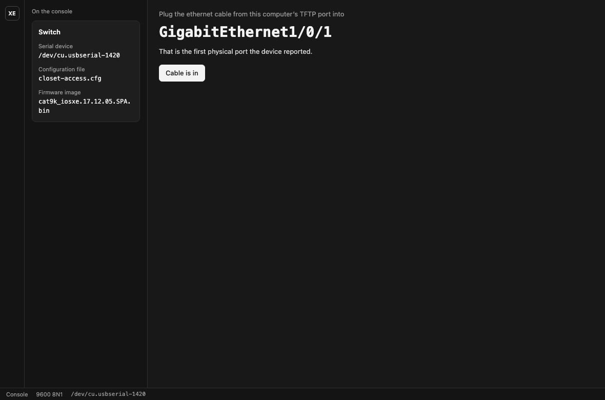

<p align="center">
  
</p>

# Cisco CBT App

> Bench factory or factory-reset Cisco IOS-XE, NX-OS, or CAPWAP access points over the console, validate what landed, and leave with a serial-numbered proof file.

[Overview](#overview) · [Screenshots](#screenshots) · [Features](#features) · [Getting started](#getting-started) · [How a run works](#how-a-run-works) · [Workspace](#workspace) · [Development](#development)


A technician plugs in a console cable, chooses **IOS-XE**, **NX-OS**, or **Access point**, then walks away with a release record that only passes when every chosen check actually passed. Switches and routers take a configuration file, with optional firmware, burn-in, and port testing. An access point takes optional firmware and/or CAPWAP addressing.

## Overview

Cisco CBT App is a desktop window on **macOS** and **Windows**. A Rust session core owns the serial console, optional TFTP firmware serve, burn-in wait, port walk, and CAPWAP addressing. One family strategy supplies the commands; the UI is a dark, Cursor-style layout drawn with web technology ([Dioxus](https://dioxuslabs.com/) desktop): activity bar, device sidebar, release record, live console transcript, and a status bar for the serial link.

| Piece | Role |
| --- | --- |
| Device family | IOS-XE, NX-OS, or Access point, chosen before Start and fixed for the run |
| Console cable | 9600 8N1 to a factory or factory-reset device of that family |
| Configuration file | Required for IOS-XE and NX-OS. Applied over the console; pass is presence in running-config. Not used on an access point |
| Firmware image | Optional on every family. Served by TFTP from a chosen ethernet port on this computer |
| Burn-in | Optional on IOS-XE and NX-OS. Whole hours after a clean reboot; checked with `show version \| include uptime` |
| Port walk | Optional on IOS-XE and NX-OS. Plug a secondary switch port-by-port |
| CAPWAP addressing | Access point only. IP, subnet mask, and default gateway from the form |
| Validation export | Text file with chassis serial, host name, and each chosen check |

> [!IMPORTANT]
> The device must be fresh out of the box or reset to factory defaults. The technician chooses the family on the form; the app does not detect it from the console. IOS-XR, small-business CLI, and Meraki stay out of scope, and the app does not talk to a wireless controller.

## Screenshots

These pictures show the switch checklist (configuration, firmware cable, port walk, release record). The live start form adds a **Device family** control above those cards. An access-point run hides the configuration file, burn-in, and port testing, and shows CAPWAP addressing instead.

### Start a run

Choose the family, the serial device, and the checks that family supports before anything is sent.


### Firmware ethernet cable

When firmware is on, plug the TFTP ethernet cable into the first physical port the device reports, then confirm. The same prompt appears for an access-point firmware upgrade.



### Port walk

After configuration validation on IOS-XE or NX-OS, walk every physical interface one at a time with a secondary switch. Access points do not walk ports.


### Ready to release

When every chosen check has passed, export a validation file that includes the chassis serial number.


## Features

- **Device family** — IOS-XE, NX-OS, or Access point. One session core; a family strategy supplies the CLI. Switching family hides options that family does not use.
- **Configuration presence check** — IOS-XE and NX-OS. Every command from the uploaded file must appear in the running config after apply + reboot. Extra lines on the device are allowed. The same rewrite allowances (interface names, ranges, hashed secrets) count as matches on both families. Access points do not apply a configuration file.
- **Optional firmware install** — image file + laptop ethernet port; elevated helper binds UDP 69, the device copies over TFTP, then install + reboot. The version token from the filename must match `show version`. IOS-XE sends `install add file flash:{image} activate commit`. NX-OS sends `install all nxos bootflash:{file} non-interactive` (that command reloads). An access point sends `archive download-sw /overwrite /reload flash:{file}`.
- **Optional burn-in** — IOS-XE and NX-OS. Whole hours (minimum 1). A clean-slate reboot starts the clock; the app waits, then requires reported uptime ≥ the entered hours. NX-OS prints units as `day(s)`; the check strips that before comparing.
- **Optional port testing** — IOS-XE and NX-OS physical ports only, once configuration has passed (including during the burn-in wait). An IOS-XE switch passes on `connected`; an IOS-XE router on up/up. NX-OS passes when `show interface {port}` is operationally up and admin state is up.
- **CAPWAP addressing** — access point only. The app sends `capwap ap ip <ip> <mask> <gateway>`, then `show capwap client config`. Pass requires that output to contain the entered IP, mask, and gateway. A failure names which of those values is missing.
- **Factory login** — the same rule on all three families: an open console, or `cisco` / `cisco`, with `Passw0rd%` when the short password is rejected. The accepted reminder stays visible for the run.
- **Safe reboot credentials** — refuses to reboot into a hashed console password the program cannot type.
- **Validation export** — chassis serial when readable, host name when readable, and each chosen check. IOS-XE and NX-OS can export once configuration has passed; unfinished optional checks are marked not finished, and a later export replaces the file. An access point exports only when every chosen check (firmware and/or CAPWAP) has passed. A CAPWAP section lists the entered IP, mask, gateway, and the result.

## Getting started

### Prerequisites

- [Rust](https://rustup.rs/) (edition 2021; this repo builds with current stable)
- A USB console adapter and a factory or factory-reset IOS-XE switch or router, NX-OS switch, or CAPWAP access point
- For firmware: an ethernet link from this computer to the device’s first physical port, and OS permission to bind **UDP 69** (the app prompts for elevation)

### Build and run

```bash
git clone https://github.com/jfmiller52/CiscoCBT.git
cd CiscoCBT
cargo run -p bench-app
```

The window opens at 1180×780. Serial devices and ethernet ports are discovered when the window starts.

> [!TIP]
> On macOS, grant the terminal (or the built app) access to serial devices if the OS asks. Firmware upgrade will ask for an administrator password so the elevated helper can bind the TFTP port.

### Start-of-run form

1. Choose the **device family**: IOS-XE, NX-OS, or Access point.
2. Choose the **serial device** for the console cable.
3. For **IOS-XE** and **NX-OS**, choose the **configuration file** (required). Optionally enable **Upgrade firmware** (image path + ethernet port on this computer), **Burn-in** (whole hours, stepper ±1 or a typed value ≥ 1), and **Port testing**.
4. For an **access point**, the form shows firmware and CAPWAP only. Optionally enable **Upgrade firmware** and/or **CAPWAP addressing** (IP, subnet mask, and default gateway). Start requires at least one of those, with its fields filled.
5. Press **Start**.

## How a run works

Family is fixed at Start. IOS-XE behavior is unchanged. NX-OS follows the same checklist with NX-OS commands from the family strategy. An access point runs a shorter path: firmware and/or CAPWAP only.

### IOS-XE and NX-OS with firmware

1. Factory login (and password reminder).
2. Prompt to plug the TFTP ethernet cable into the first physical interface → **Cable is in**.
3. Temporary IPv4 on that port for the transfer (not saved as a validation requirement).
4. Elevated TFTP serve → device copy → install → reboot.
5. Confirm the firmware version from the image filename token against `show version`.
6. Apply configuration → save → reboot → validate presence in running-config.
7. Clean-slate reboot (burn-in clock starts here).
8. If burn-in was chosen, wait the entered hours, then check uptime.
9. Port walk (if chosen) can proceed any time after configuration validation.

### IOS-XE and NX-OS without firmware

Start at the configuration apply. The clean-slate reboot still follows a successful configuration check; burn-in and port walk follow the same rules.

### Access point

1. Factory login (same rules).
2. If firmware was chosen: the same TFTP path (cable into the first physical port, temporary address, copy, `archive download-sw /overwrite /reload flash:{file}`, reboot, version token against `show version`). The temporary address is not the CAPWAP address.
3. If CAPWAP was chosen: send `capwap ap ip <ip> <mask> <gateway>` with the form values, then run `show capwap client config`. Pass only when that output shows the entered IP, mask, and gateway.
4. When both are chosen, firmware runs first, including its reboot and version check, then CAPWAP apply and validation.
5. No configuration apply, no burn-in, and no port walk.
6. Ready to release when every chosen check has passed.

### What “passed” means

| Check | Pass condition |
| --- | --- |
| Configuration | IOS-XE and NX-OS. Every meaningful line from the file is present in running-config after the apply reboot. Not chosen on an access point. |
| Firmware | Chosen only, any family. Version token in the image name matches `show version` after install. |
| Burn-in | IOS-XE and NX-OS, chosen only. After the clean reboot and the wait, uptime ≥ the entered hours. |
| Ports | IOS-XE and NX-OS, chosen only. Every physical port is connected (IOS-XE switch), up/up (IOS-XE router), or operationally up with admin state up (NX-OS). |
| CAPWAP | Access point, chosen only. `show capwap client config` contains the entered IP, mask, and gateway. |

On IOS-XE and NX-OS, export is offered once configuration has passed. Unfinished optional checks are marked not finished; a later export replaces the file with finished results. On an access point, export is offered only when firmware and/or CAPWAP — whichever were chosen — have passed.

## Workspace

```text
CiscoCBT/
├── crates/
│   ├── bench-core/   # Session engine, family strategies, compare, CAPWAP, export
│   └── bench-app/    # Dioxus desktop window, serial, NIC, elevated TFTP helper
└── docs/
    ├── images/       # README screenshots and UI fixtures
    └── superpowers/  # Design specs and implementation plans
```

- **`bench-core`** — pure Rust session logic (no UI). `strategy_for` picks IOS-XE, NX-OS, or access-point commands; the runner asks that strategy what to send.
- **`bench-app`** — desktop shell: family form, prompts, release record, console panel, serial I/O, ethernet discovery, TFTP helper.

## Development

```bash
# Library and app unit tests
cargo test -p bench-core
cargo test -p bench-app

# Desktop app
cargo run -p bench-app
```


NX-OS and access-point commands are the headers of `crates/bench-core/src/strategy_nxos.rs` and `strategy_ap.rs`, with the matching tests in `strategy.rs`. IOS-XE install is the header of `strategy_iosxe.rs`.

Screenshot fixtures (same CSS as the app) are under `docs/images/screens/` if you need to regenerate PNGs.

## Planned Features

- IOS-XR, small-business CLI, and Meraki
- Controller-side CAPWAP provisioning, or talking to a wireless controller (the access point is configured only over its console)
- Auto-detecting the family from the console
- Devices that are not factory fresh / factory reset
- Firmware over the console cable
- Talking to the secondary switch (it is plugged in by hand)
- Byte-for-byte config match
- More than one console session at a time
