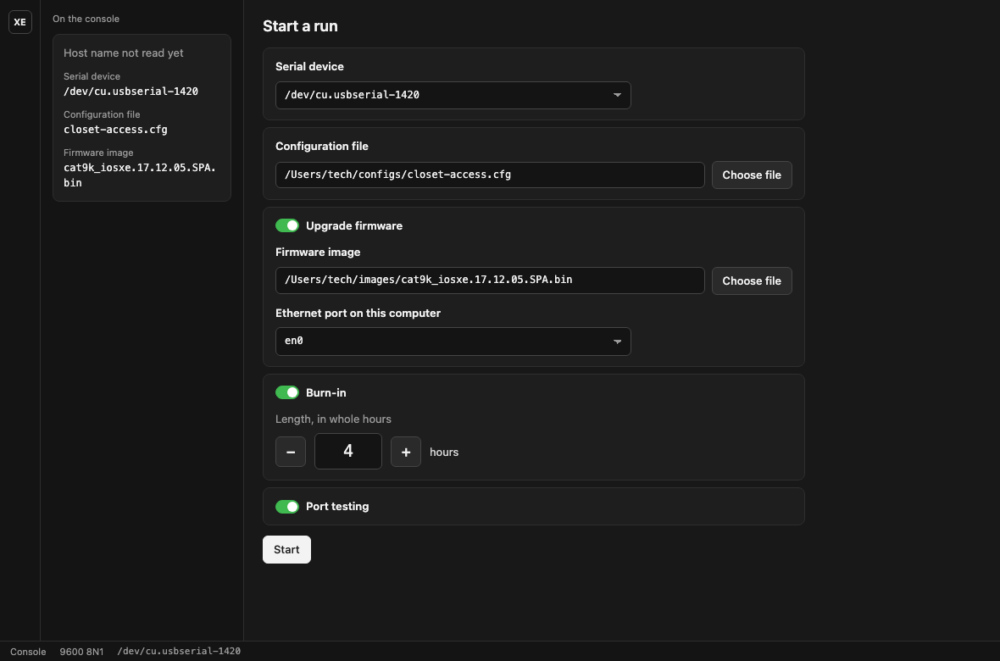
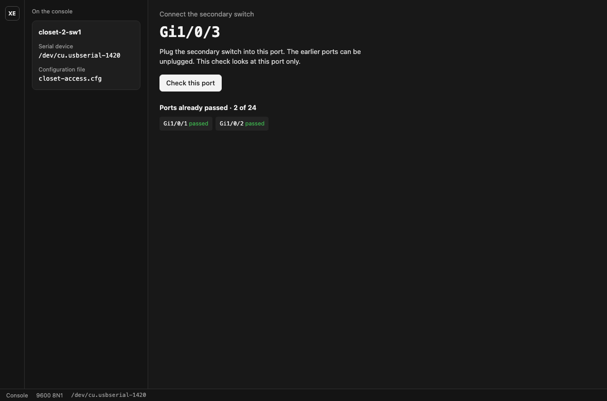
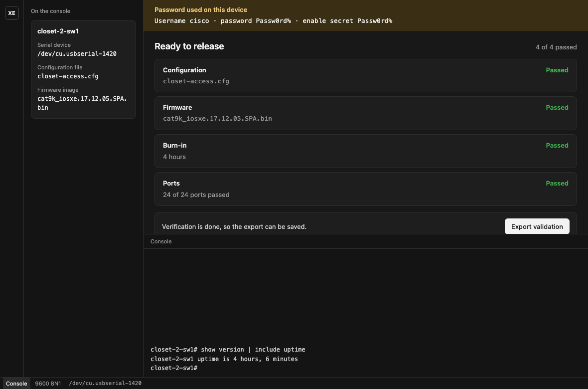

<p align="center">
  
</p>

# Cisco CBT App

> Configure factory or factory-reset Cisco IOS-XE switches and routers over the console, validate what landed, and leave with a serial-numbered proof file.

[Overview](#overview) · [Screenshots](#screenshots) · [Features](#features) · [Getting started](#getting-started) · [How a run works](#how-a-run-works) · [Workspace](#workspace) · [Development](#development)



A technician plugs in a console cable, picks a configuration file (and optionally a firmware image, burn-in hours, and port testing), then walks away with a release record that only passes when every chosen check actually passed.

## Overview

Cisco CBT App is a desktop window on **macOS** and **Windows**. A Rust session core owns the serial console, optional TFTP firmware serve, burn-in wait, and port walk. The UI is a dark, Cursor-style layout drawn with web technology ([Dioxus](https://dioxuslabs.com/) desktop): activity bar, device sidebar, release record, live console transcript, and a status bar for the serial link.

| Piece | Role |
| --- | --- |
| Console cable | 9600 8N1 to a factory or factory-reset IOS-XE switch or router |
| Configuration file | Required. Applied over the console; pass is presence in running-config |
| Firmware image | Optional. Served by TFTP from a chosen ethernet port on this computer |
| Burn-in | Optional. Whole hours after a clean reboot; checked with `show version \| include uptime` |
| Port walk | Optional. Plug a secondary switch port-by-port; switch `connected` / router up/up |
| Validation export | Text file with chassis serial, host name, and each chosen check |

> [!IMPORTANT]
> The device must be fresh out of the box or reset to factory defaults. This build speaks **IOS-XE** on switches and routers only (not NX-OS, IOS-XR, or access points).

## Screenshots

### Start a run

Pick the serial device, configuration file, and optional firmware, burn-in, and port testing before anything is sent.


### Firmware ethernet cable

When firmware is on, plug the TFTP ethernet cable into the first physical port the device reports, then confirm.


### Port walk

After configuration validation, walk every physical interface one at a time with a secondary switch.



### Ready to release

When every chosen check has passed, export a validation file that includes the chassis serial number.



## Features

- **Configuration presence check** — every command from the uploaded file must appear in the running config after apply + reboot. Extra lines on the device are allowed; IOS-XE rewrites (interface names, ranges, hashed secrets) count as matches.
- **Optional firmware install** — image file + laptop ethernet port; elevated helper binds UDP 69, device copies over TFTP, install + reboot, then version token from the filename must match `show version`.
- **Optional burn-in** — whole hours (minimum 1). Clean-slate reboot starts the clock; the app waits, then requires reported uptime ≥ entered hours.
- **Optional port testing** — physical ports only; available once configuration has passed (including during burn-in wait).
- **Factory login rules** — open console or `cisco`/`cisco`, with `Passw0rd%` fallback when the short password is rejected; reminder stays visible for the run.
- **Safe reboot credentials** — refuses to reboot into a hashed console password the program cannot type.
- **Validation export** — serial number, host name, configuration (and firmware / burn-in / ports when chosen).

## Getting started

### Prerequisites

- [Rust](https://rustup.rs/) (edition 2021; this repo builds with current stable)
- A USB console adapter and a factory or factory-reset IOS-XE switch or router
- For firmware: an ethernet link from this computer to the device’s first physical port, and OS permission to bind **UDP 69** (the app prompts for elevation)

### Build and run

```bash
git clone https://github.com/jfmiller52/CiscoCBT.git
cd CiscoCBT
cargo run -p bench-app
```

The window opens at 1180×780. Serial devices and ethernet ports are discovered when the window starts.

> [!TIP]
> On macOS, grant the terminal (or the built app) access to serial devices if the OS asks. Firmware upgrade will ask for an administrator password so the elevated helper can bind the TFTP port.

### Start-of-run form

1. Choose the **serial device** for the console cable.
2. Choose the **configuration file** (required).
3. Optionally enable **Upgrade firmware** — image path + ethernet port on this computer.
4. Optionally enable **Burn-in** — length in whole hours (stepper ±1, or type a value ≥ 1).
5. Optionally enable **Port testing**.
6. Press **Start**.

## How a run works

### With firmware

1. Factory login (and password reminder).
2. Prompt to plug the TFTP ethernet cable into the first physical interface → **Cable is in**.
3. Temporary IPv4 on that port for the transfer (not saved to startup-config).
4. Elevated TFTP serve → device copy → install → reboot.
5. Confirm firmware version from the image filename token.
6. Apply configuration → save → reboot → validate presence in running-config.
7. Clean-slate reboot (burn-in clock starts here).
8. If burn-in was chosen, wait the entered hours, then check uptime.
9. Port walk (if chosen) can proceed any time after configuration validation.

### Without firmware

Start at the configuration apply. Clean-slate reboot still follows a successful configuration check; burn-in and port walk follow the same rules.

### What “passed” means

| Check | Pass condition |
| --- | --- |
| Configuration | Always runs. Every meaningful line from the file is present in running-config after the apply reboot. |
| Firmware | Chosen only. Version token in the image name matches `show version` after install. |
| Burn-in | Chosen only. After clean reboot + wait, uptime ≥ entered hours. |
| Ports | Chosen only. Every physical port shows connected (switch) or up/up (router). |

Export is offered once configuration has passed. Unfinished optional checks are marked not finished; a later export replaces the file with finished results.

## Workspace

```text
CiscoCBT/
├── crates/
│   ├── bench-core/   # Session engine: login, apply, compare, uptime, ports, export
│   └── bench-app/    # Dioxus desktop window, serial, NIC, elevated TFTP helper
└── docs/
    ├── images/       # README screenshots and UI fixtures
    └── superpowers/  # Design spec and implementation plan
```

- **`bench-core`** — pure Rust logic and scripted console behavior (no UI).
- **`bench-app`** — desktop shell: form, prompts, release record, console panel, serial I/O, ethernet discovery, TFTP helper.

## Development

```bash
# Library and app unit tests
cargo test -p bench-core
cargo test -p bench-app

# Desktop app
cargo run -p bench-app
```

Design notes live in [`docs/superpowers/specs/2026-10-28-ios-xe-bench-design.md`](docs/superpowers/specs/2026-10-28-ios-xe-bench-design.md). The implementation plan is in [`docs/superpowers/plans/2026-10-28-ios-xe-bench.md`](docs/superpowers/plans/2026-10-28-ios-xe-bench.md).

Screenshot fixtures (same CSS as the app) are under `docs/images/screens/` if you need to regenerate PNGs.

## Non-goals (this version)

- NX-OS, IOS-XR, small-business CLI, access points
- Devices that are not factory fresh / factory reset
- Firmware over the console cable
- Talking to the secondary switch (it is plugged in by hand)
- Byte-for-byte config match
- More than one console session at a time
